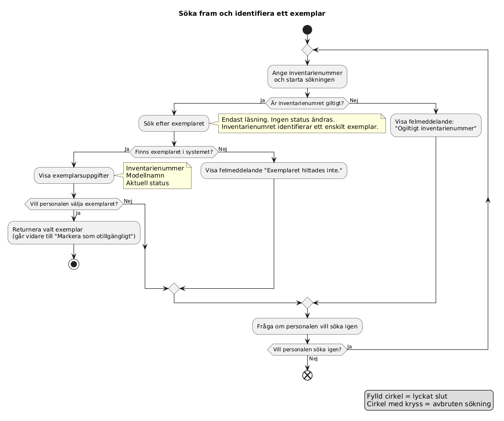
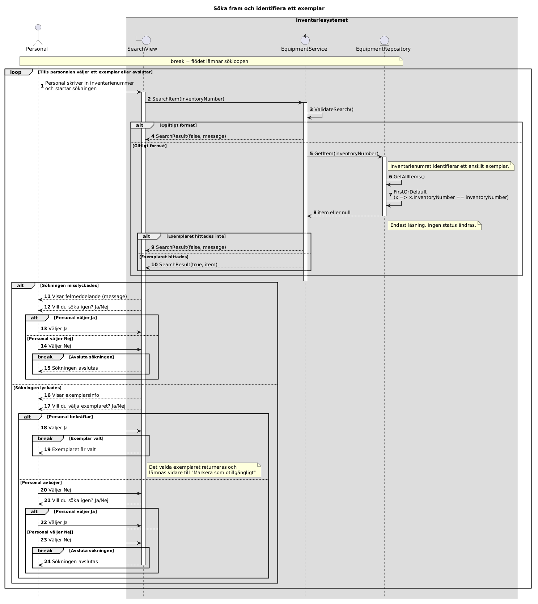
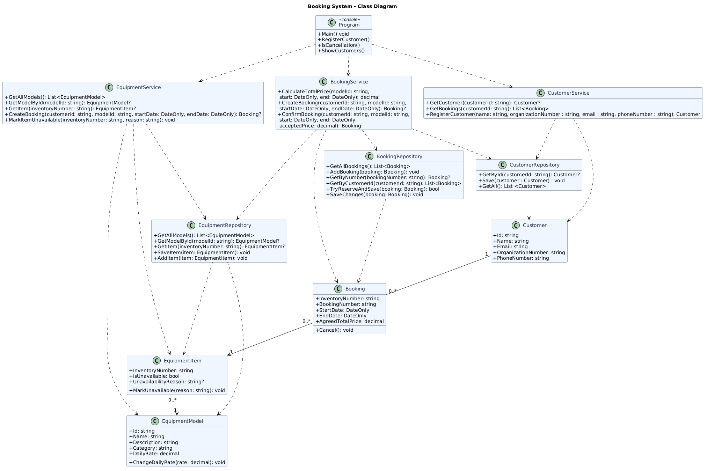

# Söka fram och identifiera ett exemplar (US-02)

Individuell uppgift för SXX Maskiner och Utrustning AB. Konsolapplikationen
visar hur personalen söker fram ett utrustningsexemplar med inventarienummer.
Konsolen simulerar den webbsida som kunden har beställt.

## Vad programmet gör

Personalen skriver in ett inventarienummer. Programmet validerar numret,
söker efter exemplaret och visar inventarienummer, modell och status.
Personalen kan sedan välja exemplaret eller söka igen. Sökningen ändrar inte
exemplarets status.

Det som ingår är sökningen och valet av exemplar. Att markera exemplaret som
otillgängligt, bokningar och kundhantering ingår inte (se avgränsning i
dokumentationen).

## Köra programmet

Du behöver [.NET SDK](https://dotnet.microsoft.com/download) (projektet är
byggt för **net10.0**, kontrollera `TargetFramework` i `.csproj`-filen).

Kör från mappen där `IndividuellUppgift.slnx` ligger:

```bash
dotnet run --project IndividuellUppgiftUserStory
```

Svara med `J` eller `N` på frågorna i programmet.

### Inventarienummer att testa med

| Nummer | Resultat |
|---|---|
| `123456` | Borrmaskin |
| `123457` | Borrmaskin (annat exemplar av samma modell) |
| `1110000` | Gaffeltruck |
| `654321` | Giltigt format, men exemplaret finns inte |
| `abc` | Ogiltigt format |

Ett giltigt inventarienummer består av 5 till 7 siffror.

## Köra testerna

```bash
dotnet test
```

Testerna är skrivna med xUnit och finns i `IndividuellUppgiftUserStory.Tests`.
De täcker huvudflödet och de alternativa flödena i diagrammen: ogiltigt format,
exemplaret finns inte och personalen avböjer att välja. Dialogen testas
automatiskt genom att `StringReader` och `StringWriter` ersätter tangentbord
och skärm.

## Projektstruktur

```
IndividuellUppgift.slnx
IndividuellUppgiftUserStory/         Konsolapplikationen (huvudprojektet)
    Entities/                        EquipmentItem, EquipmentModel, SearchResult
    Repositories/                    IEquipmentRepository, EquipmentRepository
    Services/                        IEquipmentService, EquipmentService
    Views/                           SearchView (dialogen med användaren)
    Program.cs                       Kopplar ihop lagren och startar dialogen

IndividuellUppgiftUserStory.Tests/   xUnit-tester (testprojektet)
Diagrams/                            Diagram i PlantUML (.puml) och bild (.png)
```

### Koppling mellan sekvensdiagram och kod

| Sekvensdiagram | Klass i koden |
|---|---|
| Personal | Konsolen (`Console.In` och `Console.Out`) |
| SearchView | `SearchView` |
| EquipmentService | `EquipmentService` |
| EquipmentRepository | `EquipmentRepository` |

## Diagram

Den gällande versionen är **v2.5** (mapp `Diagrams/v2.5`).







De tidigare versionerna ligger kvar i `Diagrams/v1`, `Diagrams/v1.5` och
`Diagrams/v2` för att visa hur designen ändrats.

## Antaganden och begränsningar

- Formatet 5–7 siffror är mitt eget antagande, inte ett kundkrav.
- Data lagras i minnet. Det finns ingen databas, ingen inloggning och inget
  grafiskt gränssnitt.
- Programmet avslutas efter ett sökflöde. Därefter tar nästa funktion
  ("Markera som otillgängligt") över.